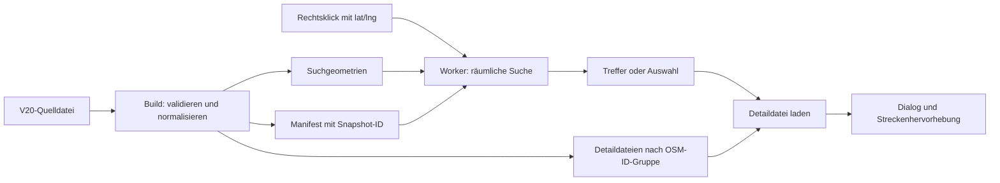

# US 35: V20-Streckendetails in RadlNavi anzeigen

Analyse vom 31. Oktober 2026 zu [RadlNavi-Issue #35](https://github.com/MunichWays/munichways-radlnavi/issues/35).
Diese Analyse dokumentiert die ursprüngliche Planung. Die inzwischen realisierte
Funktion und ihre Prüfungen sind in [Umsetzung und Betrieb](implementation.md) beschrieben.
Mit KI anhand des vorhandenen Codes und eines heruntergeladenen V20-Snapshots erarbeitet.

## Ergebnis und Empfehlung

Die Funktion ist mit dem vorhandenen React-/Leaflet-Frontend umsetzbar.
Das bestehende Kontextmenü erhält **„Details anzeigen“**. Eine räumliche Suche
ordnet die angeklickte Position einer V20-Strecke zu; ein Dialog zeigt deren
Ist-Zustand, Planung, Bewertung und Links wie in der App. Eine Auswahl und eine
Hervorhebung machen bei parallelen Wegen deutlich, zu welcher Strecke die Angaben gehören.

Empfohlen wird ein versionierter, vom Frontend ausgelieferter Datenbestand mit
separaten Suchgeometrien und kleinen Detaildateien. Die vollständige V20-Datei
wird beim Build eingelesen, nicht bei jedem Rechtsklick im Browser. Der OSRM-
Routingdienst und die Routingprofile müssen dafür nicht geändert werden.

## Geprüfte Grundlagen

- RadlNavi: `07f14a45070673ccbc71d832fd241d20083002bb`, aktuelles `origin/main` nach Abruf.
- App: `e400afc849b4ea235c2767aa1a852536871f1c9c` auf `master`.
- Daten: [IST_RadlVorrangNetz_MunichWays_V20.geojson](https://www.munichways.de/App/IST_RadlVorrangNetz_MunichWays_V20.geojson), am 31. Oktober 2026 heruntergeladen.
- Reproduzierbare Bestandsaufnahme: [inspect_v20.py](inspect_v20.py), Ergebnis [snapshot-report.json](snapshot-report.json).
- Die Aussagen betreffen diese Code- und Datenstände. Ein Browsertest der vorgeschlagenen Funktion und ein Produktionsabgleich wurden nicht durchgeführt.

| Befund | Konsequenz |
| --- | --- |
| `frontend/load_munichways.mjs` liest OSM-PBF und exportiert nur `properties.color`. | Der aktuelle Kartenlayer kann weder Detailtexte noch eine OSM-ID liefern. |
| `frontend/Dockerfile` erzeugt daraus mit tippecanoe die Kacheln unter `/layers/munichways`. | Eine V20-Datenaufbereitung lässt sich in den vorhandenen Frontend-Build aufnehmen. |
| `frontend/src/App.tsx`: `munichWaysLayer` hat `interactive: false`. | Feature-Events stehen derzeit nicht zur Verfügung. |
| `openContextMenu()` speichert Bildschirmposition und `lat/lng`; das Menü bietet Start, Ziel und Zwischenziel. | Der vorhandene geografische Klickpunkt reicht für eine separate V20-Suche. |
| Die App lädt Bewertungen und V20-Details getrennt und verbindet sie über `streetDetailsFeatureId()`. | Fachliches Mapping und Schlüsselkonzept können übernommen werden. |
| `frontend/export.geojson` ist ein OSM-Export mit 8.465 Features, darunter zwei Punkte. | Diese Datei enthält keine V20-Masterlistenfelder und ersetzt die neue Datenquelle nicht. |

App-Referenzen, jeweils auf dem geprüften Commit:
[Datenzugriff](https://github.com/MunichWays/munich-ways-app/blob/e400afc849b4ea235c2767aa1a852536871f1c9c/lib/api/munichways/munichways_api.dart),
[Modell und V20-Mapping](https://github.com/MunichWays/munich-ways-app/blob/e400afc849b4ea235c2767aa1a852536871f1c9c/lib/model/street_details.dart),
[Detailansicht](https://github.com/MunichWays/munich-ways-app/blob/e400afc849b4ea235c2767aa1a852536871f1c9c/lib/ui/street_details/street_details_sheet.dart),
[V20-Tests](https://github.com/MunichWays/munich-ways-app/blob/e400afc849b4ea235c2767aa1a852536871f1c9c/test/model/street_details_v20_test.dart).

### Tatsächlicher Datenumfang

| Messung | Ergebnis |
| --- | ---: |
| Quelldatei, UTF-8 | 27.257.956 Bytes |
| Lokal mit Python gzip komprimiert | 2.891.807 Bytes |
| Strecken / Geometrie | 19.124 / ausschließlich LineString |
| Koordinatenpunkte | 130.297 |
| Eindeutige, belegte OSM-IDs | 19.124 |
| Belegte MunichWays-IDs / unterschiedliche Werte | 14.082 / 3.599 |
| MunichWays-ID-Werte mit mehreren Strecken | 2.571 |
| Features ohne `osm_class_bicycle` | 1.532 |
| Abgetrennte Suchgeometrie, kompakt / gzip | 5.103.687 / 1.098.177 Bytes |
| Abgetrennte Details, noch ungeteilt, kompakt / gzip | 22.913.942 / 1.760.847 Bytes |

Die abgetrennten Größen wurden mit dem beiliegenden Skript berechnet. Sie
sind keine gemessenen HTTP-Transfergrößen oder Laufzeit-/Speicherbenchmarks.
Die Aufteilung in Detaildateien verursacht etwas zusätzlichen Kompressionsaufwand.
Die Quelle umfasst ungefähr 11,3665–11,7159° Ost und 48,0658–48,2524° Nord,
also einen begrenzten Münchner Ausschnitt. Das ist keine flächendeckende
Oberbayern-Abdeckung. In 5.042 Features fehlt eine belegte MunichWays-ID;
dort bleiben die verfügbaren OSM-Angaben dennoch nützlich.

**Schlüssel:** `osm_<osm_id>` als Zeichenkette, analog zur App. Eine MunichWays-ID
allein würde verschiedene OSM-Wege und möglicherweise deren Bewertungen
zusammenfassen. Im geprüften Snapshot sind OSM-IDs eindeutig. Künftige fehlende
oder doppelte IDs müssen die Veröffentlichung des neuen Snapshots stoppen,
statt Einträge still zu überschreiben. Eine spätere Unterstützung mehrerer
V20-Abschnitte pro OSM-Weg benötigt ein ausdrücklich erweitertes Schlüsselmodell.

## Vorgeschlagener Bedienablauf

1. Rechtsklick auf die Karte öffnet das vorhandene Menü. Start, Ziel und
   Zwischenziel bleiben während der Detailsuche nutzbar.
2. Beim ersten Aufruf werden Manifest und Suchgeometrien geladen; das Menü
   zeigt zunächst „Streckendetails werden gesucht …“. Ein Worker baut einen
   räumlichen Index auf. Danach werden Geometrien und Index für die Sitzung wiederverwendet.
3. Bei eindeutigem Treffer erscheint **„Details anzeigen“**. Ohne Treffer
   erscheint „Für diese Stelle sind keine V20-Streckendetails vorhanden“.
   Ein Ladefehler erhält eine eigene Meldung mit Wiederholen-Aktion.
4. Liegen mehrere Strecken im Suchbereich, öffnet die Aktion eine Auswahl mit
   Name, Bewertung und OSM-ID. Jeder Kandidat wird bei Auswahl auf der Karte
   hervorgehoben. Keine willkürliche Entscheidung zwischen parallelen Wegen.
5. Nach Auswahl wird nur die zugehörige Detaildatei geladen. Ein MUI-Dialog
   zeigt die unten beschriebenen Abschnitte; auf kleinen Bildschirmen kann er
   den verfügbaren Bildschirm ausfüllen. Scrollbereich und Schließen bleiben erreichbar.
6. Beim Schließen kehrt der Fokus zum Auslöser zurück. Escape schließt den
   Dialog; die temporäre Streckenhervorhebung wird entfernt.

Die Suche darf unabhängig vom Schalter für OSM-Bewertungsfarben arbeiten.
Die temporäre Hervorhebung zeigt die tatsächlich ausgewählte V20-Geometrie;
die Ansicht nennt ausdrücklich **„V20-Streckendetails“** und den Snapshot-Stand.
So werden unterschiedliche Aktualisierungsstände von OSM-Layer und V20 nicht
als übereinstimmend ausgegeben. Ein neuer Klick verwirft ältere Such-/Ladeergebnisse.

**Treffertoleranz als zu prüfender Startwert:** acht CSS-Pixel und höchstens
20 Meter, also der kleinere der beiden Radien. Ab Zoom 14 suchen, darunter
„Für Streckendetails bitte hineinzoomen“ anzeigen. Den Abstand zur gesamten
Linie bestimmen, nicht nur zu deren Stützpunkten. Alle Treffer innerhalb des
Radius nach Abstand sortieren und bei mehreren Treffern zur Auswahl anbieten.
Bei Kreuzungen kann eine zweidimensionale Suche Brücke und Unterführung
nicht zuverlässig unterscheiden; dafür dient ebenfalls die Auswahl.

Für Touchgeräte ist ein langes Drücken als Ergänzung sinnvoll. Die konkrete
Unterstützung des verwendeten Leaflet-Forks muss auf iOS und Android geprüft
werden; bei Bedarf ein eigener Pointer-Handler mit Bewegungsabbruch und einer
sichtbaren Alternative „Streckendetails an dieser Stelle“ im Kartenmenü.
Auf der Desktop-Tastatur kann derselbe Modus die Kartenmitte verwenden.
Das sind vorgeschlagene Ergänzungen; #35 fordert ausdrücklich den Rechtsklick.

## Darstellung und Feldzuordnung

Das fachliche Vorbild ist `StreetDetails.fromV20Json()` zusammen mit
`StreetDetailsSheet`. Daten normalisieren, optionale Werte verbergen und
Darstellung von Datenzugriff trennen. Die folgende Tabelle deckt die Felder
des aktuellen App-Mappings ab.

| Bereich | V20-Properties | Darstellung |
| --- | --- | --- |
| Kopf | `osm_name`, `munichways_name` | OSM-Name bevorzugen, sonst MunichWays-Name, sonst „Streckenabschnitt“; bei zwei Namen beide beschriften. |
| Bewertung | `osm_class_bicycle`, `color` | Klasse, Happy Bike Level und Farbe; Klasse hat Vorrang, sonst exportierte Farbe. |
| Ist-Zustand | `munichways_current`, `munichways_description`, `munichways_neuralgic_point` | Ist-Situation, Beschreibung, neuralgischer Punkt. |
| Netzzusammenhang | `munichways_route_link`, `munichways_mw_rv_route` | Streckenlinks und RadlVorrangNetz-Zuordnung. |
| OSM-Merkmale | `osm_highway`, `osm_surface`, `osm_smoothness`, `osm_bicycle`, `osm_access`, `osm_width`, `osm_lit` | Straßenart, Oberfläche, Ebenheit, Fahrradregelung, Zugang, Breite, Beleuchtung. |
| Forderungen und Netzplanung | `munichways_target`, `munichways_measure_category_link`, `munichways_status_implementation`, `munichways_net_type_plan`, `munichways_net_type_target`, `munichways_district_link` | Maßnahmen, Kategorie-Link, Umsetzungsstatus, Netztyp Planung/Ziel und Bezirkslinks. |
| Weitere Links | `munichways_links`, `munichways_mapillary_link` | Benannte Links und Mapillary-Links. |
| Technische Angaben | `munichways_id`, `osm_id` | IDs, bei numerischer OSM-ID ein Link auf den OSM-Weg. |

Leere Werte, `null`, Leerzeichen und `-` ausblenden. Zahlen einschließlich
`0` nicht durch einen Truthiness-Test verlieren. Numerische Breiten mit
„Meter“ ergänzen; bereits formatierte Werte erhalten. Route mit Linktitel
`-n/a-Alle-Wege` wie in der App ausblenden. Abschnitt ohne Inhalte nicht anzeigen.

Klassen wie in der App interpretieren:
`3` hervorragend / grün, `2` gemütlich / grün, `1` durchschnittlich / gelb,
`0` keine Aussage, `-1` stressig / rot, `-2` sehr stressig / schwarz,
`-3` unter allen Umständen vermeiden / schwarz. Unbekannte Klassen nicht
erraten. Die redaktionellen Felder `munichways_color` und
`munichways_happy_bike_level` überschreiben keine vorhandene OSM-Klasse;
das entspricht dem geprüften App-Test. Farben allein vermitteln keine Bewertung.

Die Linkfelder enthalten teilweise HTML, etwa mehrere `<a>`-Elemente in
`<p>`-Blöcken. Daraus URL und Text extrahieren und eigene React-Links erzeugen.
**Kein `dangerouslySetInnerHTML`**, keine fremden Eventhandler übernehmen.
Nur absolute HTTP-/HTTPS-URLs zulassen, `javascript:`/`data:` und ungültige
Links verwerfen; neue Tabs mit `rel="noopener noreferrer"` öffnen. Freitexte
als Text mit erhaltenen Zeilenumbrüchen rendern.

Mapillary zunächst als Link anbieten. Die App lädt zusätzlich ein Vorschaubild;
dieser Zusatz erfordert eine gesonderte Prüfung von API-Zugriff, Browser-CORS,
Datenschutz und möglicher serverseitiger Vermittlung. Keine Zugangsdaten aus
der App in das Webbundle übernehmen. Ein Feedback-Link wie in der App ist
optional; das Öffnen eines Mailentwurfs darf keine Nachricht automatisch senden.

## Technischer Vorschlag



### Datenaufbereitung und Auslieferung

- Neuer Build-Schritt, beispielsweise `frontend/build_street_details.mjs`.
  Quelle einmal laden, JSON/FeatureCollection, Koordinaten, Geometrien und
  Schlüssel prüfen. Fehler bei Pflichtangaben und Duplikaten klar melden.
  Optionale unbekannte Properties ignorieren und Statistiken protokollieren.
- Aktuell ausschließlich LineString. MultiLineString künftig entweder korrekt
  als getrennte Teilgeometrien indexieren oder den Import mit verständlicher
  Meldung ablehnen. Teilstücke niemals zu künstlichen Verbindungslinien zusammenziehen.
- Ausgaben beispielsweise unter `/street-details/<sha256>/`: `geometry.json`
  mit Feature-ID und Geometrie sowie `details/00.json` bis `details/99.json`.
  Gruppe = letzte zwei Ziffern der numerischen OSM-ID, links mit Null ergänzen.
  Jedes Detailobjekt bleibt über `osm_<id>` adressiert. Dateigrößen und die
  größte Gruppe im Build messen; bei Bedarf die Gruppenzahl später erhöhen.
- `/street-details/manifest.json` enthält `schemaVersion`, Snapshot-SHA,
  Abrufdatum, Quell-URL, Bounding Box, Featureanzahl und Pfade. Der Client hält
  die gewählte Manifestversion für alle Such- und Detailabfragen fest.
- Geometrie und Details atomar mit demselben Frontend-Image veröffentlichen.
  Snapshotpfade lange cachen, Manifest revalidieren. gzip für JSON ist in der
  vorhandenen nginx-Konfiguration bereits vorgesehen. Kein Datenstandwechsel
  mitten in einer Auswahl; bei gelöschtem alten Snapshot neu laden und erneut auswählen.
- `frontend/Dockerfile` um Aufbereitung und Kopieren der Artefakte erweitern.
  Den großen stabilen Datenbestand ähnlich den vorhandenen Kartenkacheln
  separat kopieren, damit Appänderungen ihn nicht unnötig duplizieren.
- `frontend/nginx-route-sharing.conf`: explizites
  `location /street-details/ { try_files $uri =404; }` ergänzen. Fehlende JSON-
  Dateien dürfen nicht als SPA-HTML mit HTTP 200 beantwortet werden.
- `frontend/src/setupProxy.js` um diesen Pfad erweitern; alternativ dieselben
  Artefakte lokal generieren. Der bisherige Proxy deckt nur den OSM-Kachellayer ab.
- Quelle über einen festgelegten Snapshot/Hash reproduzierbar einbinden.
  Bei fehlgeschlagenem Datenabruf bleibt die bisherige Veröffentlichung nutzbar;
  kein erfolgreiches Deployment mit stillschweigend leerem Datenbestand.
  Ein reines Frontend-Deployment aktualisiert die Daten nur, wenn der Build-
  Cache für den Datenstand invalidiert wird. Einen expliziten Datenversions-
  Buildparameter oder einen separaten Aktualisierungsjob vorsehen.

Die vorgeschlagene Aufteilung reduziert den ersten Suchdownload auf ungefähr
1,1 MB gzip; einzelne Detailgruppen werden anschließend nach Bedarf geladen
und in der Sitzung wiederverwendet. Erwartete Vorteile müssen auf einem
schwächeren Handy überprüft werden: JSON-Parsing und JavaScript-Objekte kosten
mehr Speicher als die komprimierten Dateigrößen. Eine kleine, direkt deklarierte
R-Tree-Abhängigkeit oder eine vorhandene geeignete Bibliothek bewerten;
transitive Pakete aus `package-lock.json` nicht als eigene API voraussetzen.

### Frontend-Bausteine

| Datei, vorgeschlagen | Verantwortung |
| --- | --- |
| `streetDetails.ts` | Typen, V20-Normalisierung, Bewertung, Linkprüfung; keine Karten- oder React-Abhängigkeit. |
| `streetDetailsClient.ts` | Manifest, begrenzter Cache, JSON-/HTTP-Prüfung, AbortController, Zusammenfassung gleichzeitiger Downloads. |
| `streetDetails.worker.ts` | Geometrieindex, Bounding-Box-Vorauswahl, Kandidaten und Linienabstände; Initialisierung nur einmal pro Snapshot. |
| `StreetDetailsDialog.tsx` | Lade-/Fehlerzustand, Felder, Abschnitte, sichere Links, Fokus und Schließen. |
| `App.tsx` | Aktion im bestehenden Menü, Suchstatus, Kandidatenauswahl und temporäre Polyline. |

Im Worker lokale metrische Projektion bzw. eine geeignete Geobibliothek für
Linienabstände nutzen. Den CSS-Pixelradius mit Leaflets Projektion am Klickpunkt
in den Suchradius übersetzen und den Metergrenzwert anwenden. Eine Bounding-
Box-Suche allein ist kein hinreichender Treffertest. GeoJSON verwendet
`[lon, lat]`, Leaflet meist `[lat, lng]`; die Umrechnung an einer Stelle kapseln.

Für jeden neuen Klick eine Request-ID verwenden. Nach Schließen, neuem Klick
oder Unmount Antworten älterer Worker-/Netzwerkanfragen ignorieren und
entbehrliche Fetches abbrechen. Die bisherigen `map.on(...)`-Handler im
betroffenen Effect bei der Erweiterung auch mit `map.off(...)` bereinigen,
damit erneute Registrierung keine mehrfachen Menüs oder Downloads auslöst.
Navigationszustand, Route und Zwischenziele durch eine Detailsuche nicht verändern.

### Betrachtete Alternativen

| Variante | Bewertung |
| --- | --- |
| V20 komplett beim ersten Rechtsklick laden | Einfacher Prototyp, aber ungefähr 27 MB zu parsen und alle Texte im Speicher; für die reguläre Lösung nicht empfohlen. |
| Vorhandenen VectorGrid-Layer interaktiv machen | Erfordert zuerst OSM-IDs im Export und neu erzeugte Kacheln. V20-Wege ohne aktuelle `class:bicycle`-Darstellung bleiben sonst unerreichbar; vereinfachte Kachellinien und Mehrfachtreffer erschweren die Auswahl. Als spätere Beschleunigung möglich. |
| Eigener serverseitiger Geo-Endpunkt mit räumlicher Datenbank | Sinnvoll bei wesentlich größerer Abdeckung oder häufigen Updates, für diesen Münchner Snapshot zusätzlicher Betriebsaufwand. Kein frei parametrisierbarer URL-Proxy nötig. |
| Separate V20-Kacheln plus Detailabruf | Gut skalierbar, aber zusätzliche Kachelproduktion und Abstimmung von Sichtbarkeit, IDs und Trefferflächen. Bei gemessenem Speicherproblem des kompakten Geometrieindex erneut bewerten. |

## Arbeitspakete und Abnahmekriterien

1. Datenvertrag/Build: Snapshotversion, ID-Prüfung, Feldnormalisierung, Geometrie-
   und Detaildateien, Manifest und reproduzierbarer Updateweg. Größen messen.
2. Suche: Worker/Index, Menüintegration, Toleranz und Mehrfachauswahl. Auf dem
   vorhandenen Leaflet-Fork mit Kartenrotation prüfen.
3. Ansicht: MUI-Dialog, Gruppen wie in der App, sichere Links, optionale Werte,
   Lade-/Fehlermeldungen und Hervorhebung. Danach Touch-/Tastaturergänzung.
4. Integration: Docker, nginx, Entwicklungsproxy, Cacheverhalten und unten
   genannte Regressionen. Frontend-Deployment genügt; kein Routing-Neubau.

Grobe Planungsschätzung für den beschriebenen Grundumfang: vier bis sechs
Entwicklungstage einschließlich Tests und Integration, ohne Mapillary-
Vorschaubilder und ohne umfangreiche Änderungen am mobilen Kontextmenü.
Abhängig von der UI-Abstimmung und Messungen auf Mobilgeräten; keine Zusage.

- Rechtsklick auf eine V20-Strecke bietet „Details anzeigen“; ein normaler
  Linksklick ändert den bisherigen Ablauf nicht. Start, Ziel und Zwischenziel
  funktionieren weiterhin und lösen keine Detailsuche-bedingte Neuberechnung aus.
- Altostraße, OSM-Weg `2080702`, zeigt im geprüften Snapshot unter anderem
  `class:bicycle=-2`, „sehr stressig“, den Ist-/Soll-Text und die vorhandenen
  Maßnahmen-/Bezirkslinks. Die konkrete Erwartung an den Snapshot binden.
- Zwei Wege mit derselben MunichWays-ID behalten getrennte Bewertungen und
  OSM-IDs. Parallelwege und Kreuzungen führen bei mehreren Treffern zur Auswahl.
- Fehlende MunichWays-Angaben lassen die OSM-Details sichtbar. Fehlende Klasse,
  unbekannte Farbe, `0`, leere Texte und `-` werden sinnvoll dargestellt.
- Außerhalb der V20-Abdeckung, bei zu kleinem Zoom, bei 404, HTML statt JSON,
  ungültigem Snapshot und Netzwerkausfall erscheinen unterscheidbare Zustände.
  Route und Karte bleiben nutzbar; Wiederholen ist möglich.
- Unit-Tests prüfen Normalisierung, alle Klassen, Linkextraktion und verbotene
  URL-Schemata. Geometrietests decken Linienmitte statt nur Endpunkte, Toleranz,
  Koordinatenreihenfolge, Parallelwege und getrennte MultiLineString-Teile ab,
  falls dieses Format unterstützt wird.
- Integrationstests prüfen schnellen zweiten Klick, verspätete Antworten,
  Schließen während des Ladens, einmaliges Indexladen, Fokus/Escape und
  bestehende Kontextmenüaktionen. `App.routing.test.tsx` bietet hierfür einen Einstieg.
- Manueller Browsertest auf Desktop und Handy: Rechtsklick/langes Drücken,
  Randposition des Menüs, schmale Ansicht, Kartenrotation, Mehrfachauswahl,
  Hervorhebung und sichere externe Links. Erstdownload, Wiederaufruf und
  Spitzen-Speicherverbrauch messen; bei Blockaden durch JSON-Parsing den
  Workerpfad nachbessern oder auf separate V20-Kacheln wechseln.

## Validierung dieser Analyse

Das beiliegende Skript wurde mit dem heruntergeladenen Original ausgeführt.
Es prüft den Collection-Typ, belegte/eindeutige OSM-IDs, LineString-Mindestlänge
und Koordinatenbereiche und berechnet die dokumentierten Größen. Der Report
enthält den SHA-256 der Quelle. Die Quelldatei wird wegen ihres Umfangs nicht
mit eingecheckt. `property_presence` zählt vorhandene Schlüssel, nicht ausgefüllte Texte.

Reproduktion nach Download der oben verlinkten Quelle:

```powershell
python docs/issue-35-v20-details/inspect_v20.py SOURCE.geojson --output REPORT.json
```

Den Quellhash vor einem Vergleich kontrollieren: Die URL ist veränderlich.
Die vorgesehenen Produkt- und Geometrietests waren zum Zeitpunkt dieser Analyse
Anforderungen an die spätere Umsetzung. Aktuelle Ergebnisse stehen im
[Prüfprotokoll der Umsetzung](implementation.md#prüfprotokoll).
